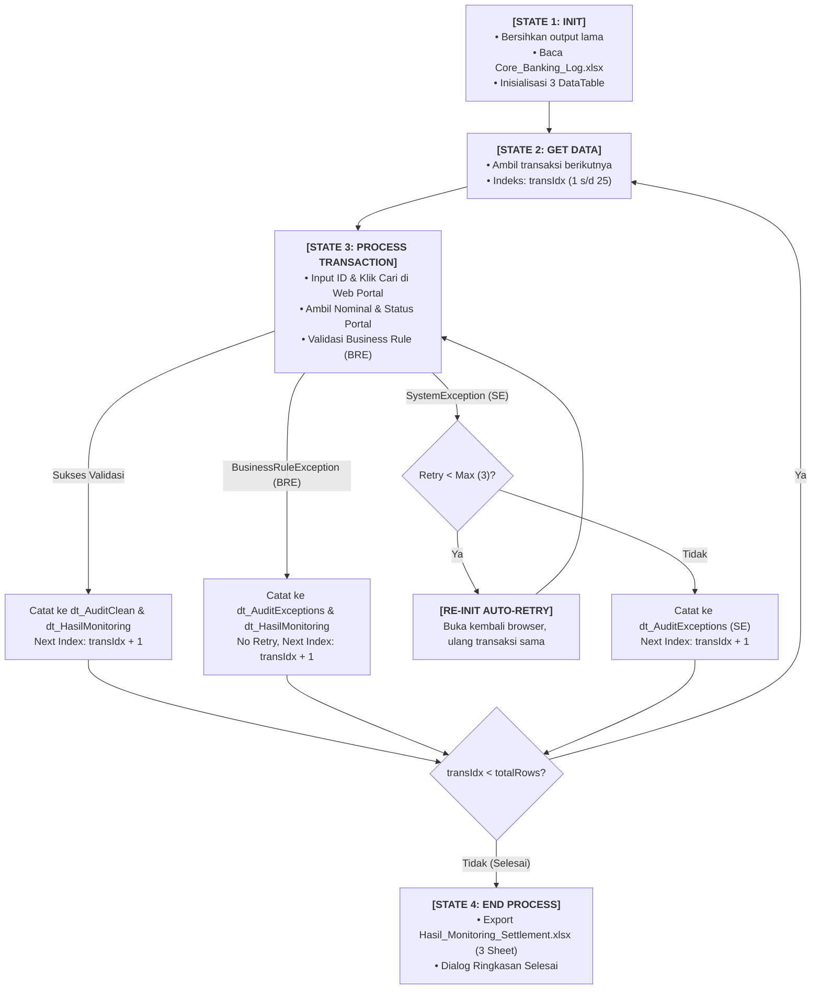
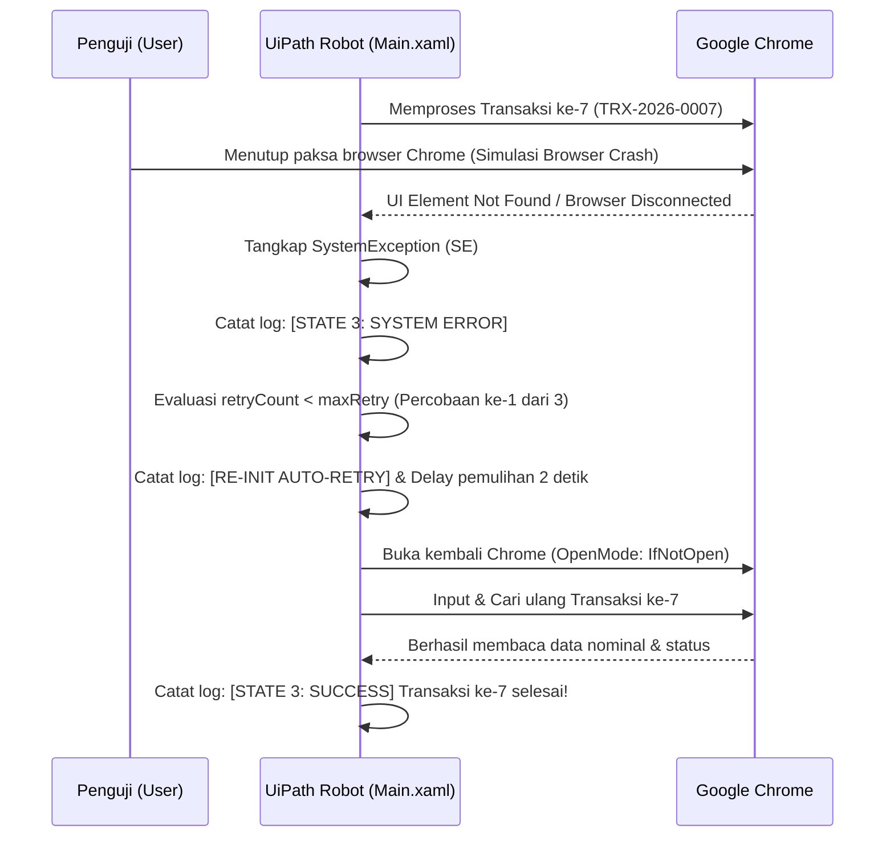

# denyiqbalmubarok-ujian-sqa6
## Robotic Banking Monitoring & Settlement Audit (Enterprise REFramework)

Proyek otomatisasi RPA (Robotic Process Automation) berbasis **UiPath Studio** yang mengimplementasikan arsitektur **Enterprise REFramework** dengan bahasa ekspresi **C#** pada target framework **Windows (.NET)**. Proyek ini menyelesaikan studi kasus rekonsiliasi dan audit settlement perbankan antara file log Core Banking dengan Portal Monitoring Settlement secara *real-time*.

---

## 📋 Daftar Isi
- [Ringkasan Proyek](#-ringkasan-proyek)
- [Arsitektur & State REFramework](#-arsitektur--state-reframework)
- [Fitur Utama](#-fitur-utama)
- [Struktur Laporan Excel](#-struktur-laporan-excel)
- [Studi Kasus & Penanganan Anomali](#-studi-kasus--penanganan-anomali)
- [Eksperimen System Error & Auto-Retry](#-eksperimen-simulasi-system-error--auto-retry)
- [Struktur Direktori](#-struktur-direktori)
- [Prasyarat & Cara Menjalankan](#-prasyarat--cara-menjalankan)

---

## 📌 Ringkasan Proyek

| Informasi | Keterangan |
| :--- | :--- |
| **Nama Proyek** | `denyiqbalmubarok-ujian-sqa6` |
| **Platform** | UiPath Studio Community (Windows / C#) |
| **File Utama** | `Main.xaml` |
| **Input Data** | `Core_Banking_Log.xlsx` (Sheet: `Core_Transactions`, 25 Transaksi) |
| **Target Web Portal** | `banking-monitoring-portal.html` (Local Browser Web Portal) |
| **Output Laporan** | `Hasil_Monitoring_Settlement.xlsx` (Multi-sheet: 3 Sheet) |

---

## 🏛️ Arsitektur & State REFramework

Alur kerja dirancang mengikuti siklus hidup Enterprise Robotic Enterprise Framework (REFramework):



### Rincian State:
1. **`[STATE 1: INIT]`**:
   - Menghapus file laporan lama secara otomatis untuk memastikan workbook selalu bersih dan bebas dari baris sisa (*ghost data*).
   - Mengambil path absolut portal web lokal `banking-monitoring-portal.html` menggunakan `new Uri(...).AbsoluteUri`.
   - Membaca 25 baris transaksi log Core Banking dari file `Core_Banking_Log.xlsx`.
   - Menginisialisasi 3 struktur `DataTable`: `dt_AuditClean`, `dt_AuditExceptions`, dan `dt_HasilMonitoring`.
2. **`[STATE 2: GET DATA]`**:
   - Mengambil data transaksi berikutnya secara iteratif berbasis indeks baris.
   - Mencatat log nomor transaksi dan percobaan retry ke panel Output Studio.
3. **`[STATE 3: PROCESS TRANSACTION]`**:
   - Membuka dan mengikat Google Chrome ke portal monitoring.
   - Mengetikkan ID transaksi ke `<webctrl id='search-trx-id' tag='INPUT' />` dan menekan tombol cari `<webctrl id='btn-search-trx' tag='BUTTON' />`.
   - Membaca nominal `<webctrl id='web-trx-amount' tag='SPAN' />` dan status `<webctrl id='web-trx-status' tag='SPAN' />`.
   - Menguji aturan bisnis (format nomor rekening dan nominal transaksi).
4. **`[STATE 4: END PROCESS]`**:
   - Mencatat log ringkasan total transaksi yang sukses dan anomali.
   - Menulis 3 sheet laporan ke `Hasil_Monitoring_Settlement.xlsx`.
   - Menampilkan `MessageBox` rekonsiliasi akhir.

---

## ⚡ Fitur Utama

- **Selector Web DOM Dinamis**: Seluruh selector pembacaan UI menggunakan atribut ID murni (`web-trx-amount`, `web-trx-status`, dll.) sehingga tidak terikat pada nilai teks tertentu.
- **Pembersihan Otomatis (Self-Cleaning)**: File laporan lama dibersihkan secara otomatis saat inisialisasi sehingga tidak terjadi duplikasi baris atau penumpukan data lama.
- **Visual Testing Experience**: Dilengkapi jeda visual 500ms agar penguji dapat melihat proses input dan hasil pencarian tiap transaksi secara visual di browser.
- **Resilience & Auto-Recovery**: Dilengkapi blok `TryCatch` dan perulangan `While` yang mampu memulihkan browser secara otomatis saat terjadi gangguan teknis (*system exception*).

---

## 📊 Struktur Laporan Excel

File output **`Hasil_Monitoring_Settlement.xlsx`** memiliki 3 sheet terpisah:

| Sheet | Jumlah Data | Deskripsi & Kolom |
| :--- | :---: | :--- |
| **`Audit_Clean`** | 22 Baris | Khusus transaksi yang berstatus **SUCCESS** (valid dan cocok 100% antara Core Banking dan Web Portal).<br/>*Kolom: ID_Transaksi, Waktu_Transaksi, No_Rekening, Channel, Nominal_Core, Status_Core, Nominal_Portal, Status_Portal, Status_Verifikasi, Catatan, Percobaan_Ke* |
| **`Audit_Exceptions`** | 3 Baris | Khusus transaksi yang terkena **BusinessRuleException (BRE)** atau **SystemException (SE)**.<br/>*Kolom: ID_Transaksi, Waktu_Transaksi, No_Rekening, Channel, Nominal_Core, Status_Core, Nominal_Portal, Status_Portal, Tipe_Exception, Pesan_Exception, Percobaan_Ke, Waktu_Log* |
| **`Hasil_Monitoring`** | 25 Baris | **Master Rangkuman** seluruh transaksi yang telah diproses lengkap dengan status verifikasi (`MATCH` / `ANOMALY`), catatan kesesuaian, dan riwayat percobaan (*Percobaan_Ke*). |

---

## 🔍 Studi Kasus & Penanganan Anomali

Berdasarkan aturan bisnis, transaksi dikategorikan sebagai anomali bisnis (`BusinessRuleException`) tanpa dilakukan retry jika:
1. **Nomor Rekening Tidak Standar**: Panjang digit bukan 10 digit.
2. **Nominal Nol**: Nominal transaksi bernilai `Rp 0`.

### Hasil Rekonsiliasi 3 Data Anomali:
| ID Transaksi | Channel | Rekening | Nominal | Status | Kategori Anomali Bisnis |
| :--- | :---: | :---: | :---: | :---: | :--- |
| **`TRX-2026-0005`** | VA | `12345` | Rp 750.000 | SUCCESS | **BRE**: No rekening tidak standar (5 digit) |
| **`TRX-2026-0013`** | BI-FAST | `1100223356` | Rp 0 | SUCCESS | **BRE**: Nominal transaksi bernilai Rp 0 |
| **`TRX-2026-0018`** | BI-FAST | `9988` | Rp 4.200.000 | SUCCESS | **BRE**: No rekening tidak standar (4 digit) |

---

## 🧪 Eksperimen Simulasi System Error & Auto-Retry

Mekanisme penanganan kegagalan sistem telah diuji dengan skenario:



### 📋 Panduan Langkah Pengujian Manual (Simulasi Freeze Transaksi ke-7):
1. **Jalankan Bot**: Buka `Main.xaml` di UiPath Studio lalu tekan **F5** (Run).
2. **Amati Single-Browser Persistence**:
   - Google Chrome hanya akan dibuka **sekali saja di awal** (Transaksi 1).
   - Pada transaksi 2 s/d 6, robot menggunakan jendela browser yang sama. Nilai ID lama pada input box dihapus otomatis, ID baru diketikkan, dan tombol cari ditekan tanpa menutup browser.
3. **Lakukan Eksperimen Manual**:
   - Saat panel Output menampilkan: `[STATE 2: GET DATA] Mengambil transaksi ke-7 dari 25 | ID: TRX-2026-0007 (Percobaan ke-1)`, segera **tutup jendela Google Chrome secara manual** (klik tombol silang `X` di kanan atas browser).
4. **Pantau Reaksi Auto-Recovery Robot**:
   - Robot mendeteksi ketiadaan browser dan mencatat:
     `[STATE 3: SYSTEM ERROR] Transaksi TRX-2026-0007 (ke-7) mengalami SystemException...`
   - Robot memicu Re-Init dan mencatat:
     `[RE-INIT] Terdeteksi kendala sistem/browser freeze pada transaksi ke-7. Membuka kembali Chrome & melakukan Auto-Retry (Percobaan ke-2 dari 3)...`
   - Robot menunggu jeda pemulihan 2 detik, lalu **secara otomatis membuka kembali Google Chrome**.
   - Robot memproses ulang transaksi ke-7 dan mencatat:
     `[STATE 3: SUCCESS] Transaksi TRX-2026-0007 (ke-7) valid dan terverifikasi MATCH.`
5. **Amati Kelanjutan Transaksi 8 s/d 25**:
   - Robot melanjutkan pemrosesan transaksi 8 s/d 25 pada jendela Chrome yang baru dibuka tersebut tanpa menutup lagi hingga akhir transaksi ke-25.
6. **Verifikasi Hasil di Excel (`Hasil_Monitoring_Settlement.xlsx`)**:
   - Buka sheet `Audit_Clean` atau `Hasil_Monitoring`.
   - Perhatikan kolom **`Percobaan_Ke`**: Seluruh transaksi bernilai `"Percobaan ke-1"`, **kecuali Transaksi ke-7 (`TRX-2026-0007`) yang tercatat bernilai `"Percobaan ke-2"`**. Ini adalah bukti otentik bahwa auto-retry berhasil dijalankan dan tercatat dalam laporan audit!

## 📁 Struktur Direktori

```text
denyiqbalmubarok-ujian-sqa6/
├── .gitignore                      # Konfigurasi pengabaian file Git (mengabaikan .local, dll.)
├── AGENTS.md                       # Panduan agent coding UiPath
├── banking-monitoring-portal.html  # Portal web lokal pengujian settlement
├── Core_Banking_Log.xlsx           # File sumber 25 data transaksi Core Banking
├── DirectMonitoring.xaml           # Workflow referensi metode langsung
├── Hasil_Monitoring_Settlement.xlsx# File laporan output rekonsiliasi (3 Sheet)
├── Main.xaml                       # Workflow utama REFramework Settlement Monitoring
├── project.json                    # Manifest konfigurasi proyek UiPath (C# Windows)
├── project.uiproj                  # File metadata proyek UiPath Studio
└── README.md                       # Dokumentasi lengkap proyek
```

---

## 🚀 Prasyarat & Cara Menjalankan

### Prasyarat:
- **UiPath Studio Community**: Versi 2024 / 2026 ke atas dengan dukungan Windows C#.
- **Google Chrome**: Browser default untuk membuka portal pengujian. Pastikan ekstensi UiPath Web Automation aktif atau opsi file URL diizinkan (`Allow access to file URLs`).

### Langkah Menjalankan:
1. Clone repositori ini ke komputer lokal Anda:
   ```bash
   git clone https://github.com/<username>/denyiqbalmubarok-ujian-sqa6.git
   ```
2. Buka file `project.json` di UiPath Studio.
3. Buka workflow `Main.xaml`.
4. Pastikan file Excel `Hasil_Monitoring_Settlement.xlsx` dalam keadaan tertutup.
5. Klik **Run** atau tekan tombol **F5**.
6. Amati pergerakan otomatis di browser Google Chrome dan pantau panel **Output** di UiPath Studio untuk melihat pencatatan log State 1 hingga State 4.
7. Setelah selesai, buka file `Hasil_Monitoring_Settlement.xlsx` untuk melihat ketiga sheet laporan audit.

